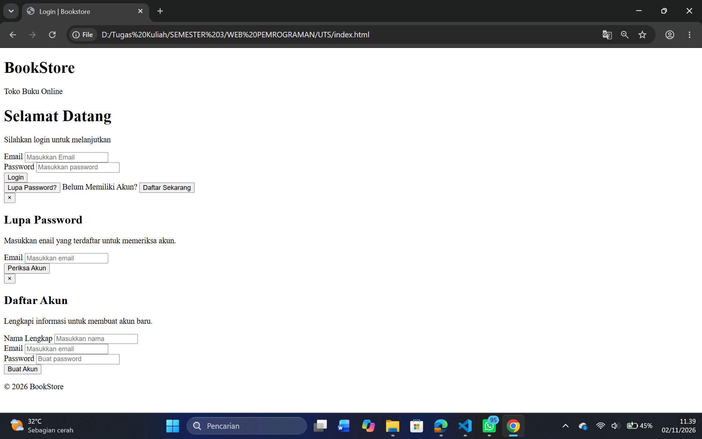

# BookStore

Website BookStore merupakan proyek front-end sederhana untuk mengelola pemesanan dan informasi buku.

## Halaman Website

1. **Login (`index.html`)**  
   Halaman untuk pengguna masuk ke dalam sistem menggunakan akun yang tersedia.
   berikut tampilan sebelum menggunakan CSS:

ini tampilan sesudah menggunakan CSS:

setelah login berhasil kemudian muncul:

2. **Dashboard (`dashboard.html`)**  
   Halaman utama yang menampilkan ringkasan dan menu navigasi website.
   berikut tampilan menu utama:
   

3. **Stok Buku (`stok.html`)**  
   Halaman untuk melihat dan mengelola data katalog serta stok buku.
   berikut menampilkan stok/katalog buku:
   

4. **Checkout (`checkout.html`)**  
   Halaman untuk melakukan pemesanan buku, melihat ringkasan pembayaran, dan riwayat transaksi.
   berikut halaman pemesanan buku:
   
   setelah pemesanan berhasil kemudian muncul history transaksi:
   
   

5. **Tracking (`tracking.html`)**  
   Halaman untuk melihat informasi dan status pengiriman pesanan berdasarkan nomor DO.
   melihat tracking Rina:
   
   melihat tracking agus:
   

## Teknologi

- HTML
- CSS
- JavaScript
- LocalStorage

## Catatan

Proyek ini menggunakan data dummy dan penyimpanan LocalStorage sebagai simulasi tanpa menggunakan database maupun backend.